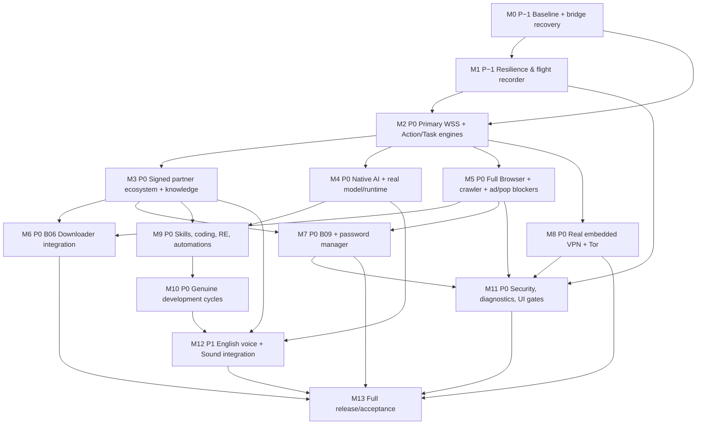

# ASTERION CONTROL — V6 COMPLETE IMPLEMENTATION & DEVICE ACCEPTANCE ROADMAP

**Date:** 2026-11-19  
**Status:** Owner-approved implementation roadmap; **NOT evidence of an implemented, deployed or accepted release**.  
**Canonical repository:** `Azrazieliz/Asterion-Comander`  
**Continue branch:** `work/control-0927-overnight-cycles-20261111` (use a verified newer owner-approved descendant only; do not silently switch to `main`).  
**Primary contract:** [V6 owner corrections, approved R01–R08/R10, B06/B09, password manager](CONTROL_V6_OWNER_CORRECTIONS_20261119.md).  
**Historical specifications still governing when non-conflicting:** [V3 architecture](CONTROL_V3_COMPLETE_DESIGN_NO_CODE_20261115.md), [V4 24 real execution systems](CONTROL_V4_VPN_EVIDENCE_AI_TRAINING_SYSTEMS_RESEARCH_20261115.md), [V5 Browser/Codex/Rounder contract](CONTROL_V5_USAGE_GEO_BROWSER_REUSE_12000_EVAL_20261115.md), [V5 model quality/geo criteria](CONTROL_V5_GEO_USAGE_ROUNDER_MODEL_TRAINING_REVIEW_20261115.md), [7★ diagnostics](7STAR_CONTROL_DIAGNOSTICS_REALTIME_VPN_SECURITY.md), [signed partner bridge v1](CONTROL_CROSS_APP_API_V1.md), [progress receipts](../PROGRESS.md).

> **WORK TICKETS CREATED:** [Master #3](https://github.com/Azrazieliz/Asterion-Comander/issues/3); [M0 #4](https://github.com/Azrazieliz/Asterion-Comander/issues/4), [M1 #5](https://github.com/Azrazieliz/Asterion-Comander/issues/5), [M2 #6](https://github.com/Azrazieliz/Asterion-Comander/issues/6), [M3 #7](https://github.com/Azrazieliz/Asterion-Comander/issues/7), [M4 #8](https://github.com/Azrazieliz/Asterion-Comander/issues/8), [M5 #9](https://github.com/Azrazieliz/Asterion-Comander/issues/9), [M6 #10](https://github.com/Azrazieliz/Asterion-Comander/issues/10), [M7 #11](https://github.com/Azrazieliz/Asterion-Comander/issues/11), [M8 #12](https://github.com/Azrazieliz/Asterion-Comander/issues/12), [M9 #13](https://github.com/Azrazieliz/Asterion-Comander/issues/13), [M10 #14](https://github.com/Azrazieliz/Asterion-Comander/issues/14), [M11 #15](https://github.com/Azrazieliz/Asterion-Comander/issues/15), [M12 #16](https://github.com/Azrazieliz/Asterion-Comander/issues/16), [M13 #17](https://github.com/Azrazieliz/Asterion-Comander/issues/17). All open until real verified acceptance.

## 0. Absolute execution contract: deliver functioning systems, not appearances

This is the complete roadmap for the actual app, not another UI concept or code-only exercise. **Do not end implementation because a page looks right, an API exists, a test mock passes, a model file is named, an APK builds, a worker acknowledges a job, or a feature is documented.** Each feature needs **real implementation → deterministic tests → integrated Windows and Android execution → relevant real-phone acceptance → visual/functional regression → truthful evidence and safe release**. When an owner/system permission or legitimate external-service limitation blocks a gate, record the exact blocker and continue all independent work; never fabricate success.

**Finish-to-end requirement:** complete every approved V3/V4/V5/V6 system in scope, the original 20 approved modules, R01–R08/R10, B06/B09, English voice, shared password manager and actual Control Android/Windows integration. The only AI work explicitly allowed to continue after the first genuinely functional release is **substantial additional long-term training**; native on-device inference, advanced/useful reasoning at measured device-feasible capability, working model/runtime, memory, fast routing, browsing, tool use and real first-use evidence are **not** deferred. A full-product final claim waits for every applicable acceptance criterion or a clearly reported genuinely unavoidable external/OS blocker.

**Non-negotiable preservation:** do not discard/recreate original Windows worker, service/watchdog, signed Android package `com.asterion.control`, user data, owner key/cert, pairing, private native WSS, existing fallback GitHub bridge, working native API, approved designs, Model/Skill assets, specialist app owners, or previous confirmed features. Original Android certificate SHA-256 recorded in prior release evidence: `9bc439712a0a460cc4703ebf254aaaf9bf3cc6e67b0ced6fc12162ed3ca3b9ad` (reverify against real owner baseline before packaging/install). Keep native authenticated `/phone/live` route; **never** reintroduce the retired MCP gateway or unapproved new remote pairing. Do not rewrite or rebuild Downloader under Control authority.

**Approval boundary:** owner will handle unavoidable Android/system permission confirmations when prompted (e.g., `VpnService.prepare`, MediaProjection, accessibility, possible Autofill service selection, microphone, biometric and other OS-mediated consents). Implementers own all other provider retrieval, source/model dependency preparation, technical setup, building, integration, actual observation and troubleshooting; do not hand back a tutorial or manual scripting task.

**Priority:** **P−1** recurring bridge reliability and real universal diagnosis; **P0** all other approved domains except **P1** English-only voice. Do not postpone mandatory P0 security or premium UI until the end; apply them in every milestone.

**Name:** Asterion Control. No second assistant brand. **Browser:** DOWNLOAD, not digitize. **Browser options additionally approved:** B06 and B09 only; B01–B05/B07/B08/B10 are suggestions only, NOT requirements unless separately approved. **R modules approved:** R01–R08 + R10; **R09 is unapproved** (safe existing disk preflight and cleanup obligations remain).

### 0.1 Hard prohibition on functionality duplication

**Rule:** Do not invent a second app, engine, model, parser, download service, media extractor, editor, tagging database, device stack, credential store or permissions manager when a working relevant capability exists in a signed Asterion app or in Android/Windows. Reuse prior code and owners; extend the original engine or its signed provider through its authorized maintainer, not through a parallel copy inside Control. **Functional overlap must be audited before any new source file.** Source reuse requires proper licensing and owner authority.

| User intent | Owning execution engine | Control's permitted role | Explicitly prohibited |
|---|---|---|---|
| Image generation/edit | **Asterion Art** | Intent selection, typed request, preview/status/result, model/mode knowledge | Second image generator or duplicate Art model collection |
| Music/audio generation | **Asterion Sound** | Music intent and signed Sound jobs; shared voice-pack inventory | Separate Control music generator |
| 3D create/modify/render | **Asterion 3D/3D Foundry** | Typed operations, progress, assets, interoperability | Second 3D engine/render core |
| Classification, tags, character knowledge | **Core/Nexus** | Scoped diagnostics, status, inference delegation and outputs | Duplicate knowledge IDs, taxonomy or training data |
| Source/provider media acquisition, download scheduler, multi-part transfers | **Downloader** | Browser direct-link handoff, signed batch requests, progress and integrity status | Second site extractor, provider adapters, parallel segmented download engine or queue |
| Documents, PDF/EPUB/Office, archives, previews | **Rounder** | Open-with, analysis requests and artifact handoff | Second reader/editor, PDF/EPUB/Office backend or file organizer |
| Text authoring | **Writer** | Goal, instructions, model/mode selection, finished assets | Separate specialist writing model ecosystem |
| Courses, tests, studying | **Adaptive Study** | Study intents and course-specific app bridge | Second courses database or course generation screens |
| Gameplay tasks, source mechanics, guides | **Game/Codex/Pilot** | Shared generic Browser retrieval and signed game task dispatch | Re-rank canon, duplicate Codex roster/game databases |
| Koikatsu/Windows game compatibility | **KK** | Task launch, logs, Wine/Unity traces and diagnoses | Duplicate game runtime or rebuilt game |
| World/game simulation | **NoWorld** | Launch/diagnostics/assets through original partner | Duplicate simulation renderer |
| Generic web navigation/source capture | **Control Browser** | One genuine browser, rendering, browsing and generic research crawlers | Site-specific Downloader media adapters or Rounder reading engine |
| Site passwords/passkeys/session state | **Single Control credential service + Android credential APIs** | One secure `Passwords & Sessions` interface, origin-scoped credential access | Multiple app-specific password databases or plaintext copies |
| App/site permissions | **Control Security & Privacy / Android OS** | B09 single unified site-permissions interface | Another parallel permission authority |
| Cross-device remote commands | **Original native WSS + Windows worker** | Trusted, typed fast tool route and reliable receipts | Rebuilt gateway, duplicate pairing or GitHub-per-gesture workflow |
| VPN and DNS/ad blocking | **One Control VpnService** | Real tunnel and route policies, browser network/resource/cosmetic filters | Competing second Android VpnService just for adblock |

**Required preflight ledger for every source change:** `requested_capability`, `owning_app_or_OS`, `current_implementation`, `verified_reusable_surface`, `missing_contract`, `Control_changes_only`, `partner_owner_work_needed`, `no_duplication_test`, `phone_acceptance`. A feature cannot be marked DONE with unresolved ownership/overlap.

### 0.2 Source-of-truth and quality invariants

- Source + release provenance: commit → branch → toolchain/model weights → APK/hash/signer → transfer receipt → install receipt → screenshot/interaction/video/engine postcondition. Never equate one stage with a later stage.
- Android data/storage remains unchanged across app update; no uninstall/re-pair/rekey/recreate. Test exact same signing identity.
- Devices and user projects are not expendable test fixtures. Use isolated build/test repos, reversible test flows, backups with scope and release rollback.
- Never delete user files or unrelated model caches to make space. Existing generated temporary build locations can be cleared only after verifying origin, ownership and no live process; do not assume an unapproved R09 UI/module exists.
- No mandatory paid AI, VPN, GPU, cloud, app store fee or foreign owner server. External free network exits must be real. Keep SuperVPN excluded.
- Only real tools/verified responses. Distinguish `pending, queued, running, blocked, failed, outcome_unknown, built, transferred, installed, device_verified`, including timestamps and responsible provider.
- Full Android permission prompts belong to the owner; preparation, app implementation and next-stage continuation remain implementer tasks. No silent Android authorization or bypass of other app private data.
- No placeholders: a button, panel, adapter, training result, browser feature, model or VPN path with no functional executor fails promotion.
- Every UI screen/dialog, especially logs/advanced/network/recovery, must be genuinely premium with informative empty/error states, hierarchy, accessibility, precise text and working navigation/handlers—not a raw API/matrix or debugging screen disguised as an app.
- Keep testing and implementation moving across independent features while blocked, never claim full completion or repeatedly re-ask previously approved scope.

## 1. Milestone graph — do not substitute elapsed time for test-gated completion



This is a **dependency graph, not a promise of particular dates**. Nonconflicting work may proceed concurrently in isolated changes; P−1 connectivity must remain protected. UI, security, correctness and privacy checks accompany every milestone. The graph does not waive any V3/V4 modules.

| Milestone | Priority | Core deliverable | Cannot advance without |
|---|---|---|---|
| **M0** | **P−1** | Source/runtime inventory, preserve working connections, audit repeat bridge crashes, disk, watchdog and deployment readiness | Baseline tested + existing user state backed up/untouched |
| **M1** | **P−1** | **R01 Sentinel, R02 Flight Recorder, R08 Regression Lock** + signed app diagnostic evidence | Repeat fault injection/recovery and real incident export |
| **M2** | **P0** | Primary authenticated WSS, cellular, low latency, exact action/task/scheduler/cancel/receipt semantics | Real Wi-Fi-off cellular device action and state verification |
| **M3** | **P0** | Signed ecosystem integration, per-app knowledge packs, intent router (R03/R04), useful Core/Downloader/3D flows | Real paired invoke/status/cancel/evidence across participating apps |
| **M4** | **P0** | Full optimized native AI, model sourcing, memory, accurate tools, model lab/evaluation | Real offline inference and useful native tool actions |
| **M5** | **P0** | Genuine Browser, AI crawlers, powerful ad/tracker/pop/redirect blocker, media/site/download capture, R05 workbench | Real pages/tabs/search/sessions/render/download/filter/crawler acceptance |
| **M6** | **P0** | **B06** advanced resumable/segmented downloads **delegated to Downloader**, integrity & queue UX | Existing Downloader ownership and signed real transfer receipt |
| **M7** | **P0** | **B09** unified per-site permissions + integrated password manager and durable sessions | Exact-origin access, secure autofill, restart without repeated login |
| **M8** | **P0** | **R06 working full-device VPN** through legitimate free-provider retrieval and first phone activation + separate Tor | Actual Android consent, tunnel, changed public IP, 30–60min rotation & >=75% measured throughput where attainable |
| **M9** | **P0** | Real developer studio, external RE/R10, document delegation, data tools, automation/skills | Verified source modifications, code/data outputs, safe external compatibility test |
| **M10** | **P0** | Independent continuous overnight development engine with real multi-turn output and ChatGPT-only context rollover | Verified real replies, committed/tested project changes, crash resumption, no duplicate Send |
| **M11** | **P0** | Cybersecurity, scanning, privacy, universal premium UI, resource governor, OS permission fidelity | Real known-risk/false-positive scans, full UI interaction and regression suite |
| **M12** | **P1** | English-only wake/voice/dialogue/Sound voices, opt-in and music-friendly audio | Real owner-consented English voice commands and interruption tests |
| **M13** | **RELEASE** | Signed upgrade, on-device installation, full app/domain acceptance, user-facing stable handoff | 100% release gates met or real external blockers explicitly unresolved; never fake "done" |

### 1.1 M0: first work in new implementation conversation

1. Fetch newest `PROGRESS.md`, this roadmap, V6, read original `README.md`/native WSS/bridge contract, relevant active source, source signer/build scripts and the current bridge README; verify actual branch, latest commit and installed APK version. Preserve old rollback decisions and do not redeploy previously rejected experimental state-aware gateway changes.
2. **Read-only first:** query Windows worker `pc_status`, `phone_bridge_status`, `phone_status`, watchdog/service task identity and last errors, Python import/test/build toolchain, disk free and worker recovery logs. Existing Nov19 receipts showed fallback worker answered and direct WSS was reported connected over **Wi-Fi**, **not cellular**.
3. Resolve documented contradiction: `Asterion Control Self-Healing Worker` scheduled-task `Ready` in one Nov18 receipt, `WATCHDOG_TASK_NOT_ENABLED_OR_MISSING` in another. Confirm exact task name, path, triggers, process parent/child, last start, failure handling, logging, user privilege and receipt freshness. Do not declare repaired on one `pc_status` response.
4. Audit original service launch paths and ensure a permitted backup-first reload mechanism exists. Earlier deployment added cellular WSS/backend on disk but running services were not reloaded; a previous remote restart attempt was blocked. Do not circumvent a tool/safety restriction or replace the service with a second gateway; use an allowed service management path or owner OS action only if truly required.
5. Low Windows free space was observed (~C 225 MB, D 784 MB on Nov18), incompatible with model compile/package work. Identify safe *project-generated* scratch/build files and legitimate alternative stage volumes before cleaning. Preserve user assets and projects. Do not use the phone's ~86 GB free storage as proof the Windows compiler has enough room.
6. Establish isolated branch/worktrees, identical deterministic regression fixture and evidence receipts. Inventory current failing tests (earlier full Python run 267 passed/30 failed) and distinguish obsolete retired-contract expectations from genuine regressions; never “fix” by resurrecting retired gateway.
7. Record a connected first real Android action on Wi-Fi, then actual cellular with Wi-Fi off when owner/device state permits; do not disrupt foreground user activity or pending ChatGPT draft. Collect action result and UI/engine postcondition and compare p50/p95 when sample size permits.
8. Implement/verify R01 minimal independent watchdog and R02 flight recorder **before using unstable AI to repair itself**. Tag critical failures for R08 regression protection.

**Exit M0/M1 only when** the worker and Android control survive multiple intentional stop/restart/network faults, report exact root cause and safely auto-recover where permitted, and generate an actual incident evidence bundle. A successful command alone does not satisfy P−1.

### 1.2 M1: resilience, flight recorder, recovery, permissioned logcat

- Native WSS heartbeat separate from UI/model, relay/Windows API health, status including `last_success` freshness, startup dependency checks, service supervisor and stale-session detection, circuit-breaker on restart loops, monitor free disk/CPU/memory with truthful values.
- R02 events: monotonic/UTC time, device/app/cert/version, request/job/trace ID, action state, network path, HTTP status, queue/worker stage, model inference stage, crash/ANR/process exit where OS permits, screen/DOM snapshot provenance, bounded PII-redacted logs and body hashes; correlation UI groups errors by incident rather than scattering debug text.
- **Core and Downloader**: existing bridges alone are insufficient; add/coordinate opt-in signed diagnostics and operations in their own owning repositories. Android app-private logcat cannot be silently read by another third-party app: prefer partner `ApplicationExitInfo`, own-process events, explicit diagnostic export, or Android-developer PC ADB permission when actually authorized. Collect actual engine/HTTP/downloader diagnostics; show genuine gaps.
- R08: protect last verified connection, signed install, downloads, cycle and transfer operations from regressions; fail CI/canary on known recurring major defect; staged rollout and backup/rollback.
- Acceptance: deliberately cause supported local process failure, silent network loss, stale WSS session, queued request timeout, Android foreground switches and one partner crash. Verify incident ID, owner-friendly cause, safe recovery/no duplicate execution and actual restored service.

### 1.3 M2: native primary WSS, accurate action/task engine, long-running automation

- Use existing phone-outbound secure WSS as primary Control/AI tool transport; signed/authenticated `invoke/status/cancel/observe`, queued job IDs, delivery and outcome receipts, safe retry/idempotence and `OUTCOME_UNKNOWN` reconciliation. Local authenticated loopback WSS bridge is not a new public gateway.
- Worker-resident pipelines for multi-action tasks, real parallel independent operations and bounded backoff avoid GitHub per tap. GitHub fallback remains emergency way for ChatGPT to reach the existing worker until a truly supported in-chat direct channel exists; **never invent one**.
- Verify network handover across Wi-Fi/cellular, mobile carrier NAT and screen lock/idle/Doze; no fabricated claims of remote shell on Android.
- Distinguish immediate **Action** (single checked effect), finite **Task** (DAG, parallel groups, retries, cancellation) and genuine **Overnight Cycle** (separate M10 supervisor with substantive project turns). Personal schedules/triggers live in Task Automation, not a cycle.
- Measure decision+model+queue+transport+execution+postcondition p50/p95 for real phone tasks, not worker-only delay.
- Use Android standard Accessibility and supported signed app APIs, preserve security boundaries; screenshot/video only with actual MediaProjection consent.

### 1.4 M3: truly interactive ecosystem and knowledge packs

- R03 knowledge packs: for every installed cooperating app, record package+signer+version, state, source repo ownership, real action schema, modes, local model requirements, input formats, expected output hashes, known failure triage, commands, compatible downstream apps and user corrections; version and test each pack.
- R04 native intent fast path: image→Art, music→Sound, 3D→3D Foundry, writing→Writer, study→Adaptive Study, tagging/character knowledge→Core, generic URL→Browser, media-acquisition→Downloader, document reading→Rounder, game info→Codex/Pilot, KK original game→KK, world simulation→NoWorld. Do not route requests by superficial title alone if multiple valid providers; resolve ambiguity with minimal relevant context.
- App catalog: verified installed/active/signed, approved capabilities vs permission needed vs uninstrumented, useful native controls, live job states, incident history, selected model/mode and output preview/handoff. No raw command schema shown as default user interface.
- Signed v1 ContentProvider `invoke/status/cancel` retained. Add typed capability descriptions, artifact references, opt-in event and diagnostics streams, version checks, detailed progress, cancellation results, limited preview URIs, no arbitrary private app paths.
- Real integration acceptance for **Art, Sound, 3D, Core, Downloader, Writer, Study, Game/Codex/Pilot, KK, NoWorld, Rounder** whenever the partner's signed API supports the action. If unsupported, request its owning maintainer to extend the original provider; don't create a Control substitute and don't falsely label it supported.
- Critical proof: one real image request invokes Art (not generated inside Control), one music request invokes Sound, one 3D operation invokes Foundry, and Core/Downloader return actual bounded logs/engine events and useful actions.

### 1.5 M4: complete device-optimized native AI/model lab

- Check current real Samsung RAM, storage, sustained heat, Android version, CPU/GPU/NPU stack and available runtimes; evaluate 1–2 strong open-weight phone-suitable model candidates **on verified real tasks**. No model performance promises from filenames/leaderboards.
- Source trustworthy licensed weights/runtime (llama.cpp/other vetted engine), verify immutable hashes/model card, supply actual Android ARM64 `.so` and tokenizer/config, use accelerated kernels only if measured beneficial, quantization/KV/sampling/batching/performance governor, failure rollback. Do not ship a dummy or mismatched GGUF.
- Native streaming chat, secure project memory/RAG, tool grammar, context compaction, source evidence, app-specific knowledge packs, powerful coding/research/tool-use and cross-app action selection; deterministic path for trivial requests and deeper model for hard ones; optional Windows inference for heavy tasks.
- Model Forge: inventory, downloadable model provenance/licenses/checksums, version/compatibility, phone speed/battery/thermal benchmarks, A/B accuracy and rollback. Voice model belongs to Voice subsystem; specialist creative models stay in owning apps.
- Training tiers: verified examples and skills, retrieval/context, optimizations, LoRA/QLoRA if suitable PC GPU/hardware and rights; sealed 50,000 true holdout + 200,000 stress + 2,000 real integrated + 1,000 human review maturity targets, no contamination/false pass.
- **M4 exit:** real working offline chat on phone, typed action invoked through same native WSS/tool route, useful app-aware response, memory retrieval, clear failure/blocked statuses, resource profile and no missing runtime/weights. Only future large-scale training is allowed to continue later.

### 1.6 M5: full Browser, ad/pop blockers and AI web research

- Ship a real polished Android Browser, not only a crawler or blank WebView: stable JS-heavy rendering, tabs/tab restoration, history/bookmarks, URL/search, login/cookies/profile separation, desktop mode, media/stream handling where platform supports it, user-owned page navigation, downloads and safe cross-app links. Compiled screen is insufficient.
- **Mandatory extreme browser ad/tracker blocking:** reputable updated filter lists (network and supported cosmetic), malicious advertising/tracker domains, real per-site blocked counter, custom user rules/allowlist, legitimate page-breakage handling, update provenance, and tests across different kinds of sites. Intercept resources and control JavaScript/window/permission behavior; do not claim universal interception when WebView/service workers/in-stream ads prevent it.
- **Mandatory popup/pop-under/forced-redirect shield:** deny unwanted non-user-gesture windows/tabs/external-intent launches, notification spam, malicious redirects and overlay attempts, while preserving legitimate user opens with exceptions.
- Browser own ordinary direct file/download UI (saved/queued/active/failed, progress, verified output). Browser does **not** own Downloader provider engine. Keep direct Android DownloadManager or minimal current Android file API for standard file saving; B06 delegated in M6.
- R05 research workbench: AI Internet crawlers search/summarize owner requests, fetch public sites with robots/rate/SSRF constraints, optional JS/browser render for actual DOM, provenance hash/UTC/source URL, compare and cite primary sources, save clips and hand evidence to signed apps.
- Tor pages require actual Tor implementation, not a Tor tab with direct traffic. Respect site access rights, credentials, and anti-bot; do not call every 403 a geographic block.
- Acceptance: multi-tab JS and media pages, login preserved, safe legitimate popup allowed vs intrusive blocked, representative tracking/ads blocked, real downloaded file integrity, site exceptions, no external-app auto launches, actual crawler answer with checked sources and working Codex handoff.

### 1.7 M6: B06 via Downloader — no duplicate download engine

- Query existing Downloader signed bridge for typed `transfer.submit/status/cancel/retry/result`, transfer engine's resume/parallel range/queue/integrity/dedup capabilities, ownership and version. If unavailable, log a **partner-side** request and coordinate with Downloader owner. Do not rewrite Downloader's source from Control work.
- Browser sends URLs/content metadata/destination requests within Android URI grants and owner policy. Downloader handles segmented parallel HTTP ranges when server allows, worker capacity, retries, source-specific provider extraction, queue statuses, real bytes/hashes and atomic completion; Control only renders integrated job status and handles grants/permissions.
- When native Browser saves a simple ordinary link without partner involvement, use bounded OS/basic direct-download path, not a second competing segmented scheduler.
- Acceptance: at least two real supported resumable downloads through signed Downloader engine after network loss, no duplicated file or job, controlled pause/resume/cancel, verified integrity and same result visible in both apps. If the required partner API is missing, **not completed** regardless of the Browser UI.

### 1.8 M7: B09 permissions + secure password manager + persistent logins

- **One permission authority:** B09 is the premium Browser façade over existing Control Security & Privacy + Android WebChromeClient/site permissions; per-origin camera/mic/location/notifications/file/clipboard/external navigation request/grant/revoke audit, expiration and defaults. No independent duplicate permissions database.
- **One credentials vault:** first inventory Android Credential Manager, Autofill service, AccountManager, platform provider policies, existing Control secrets. Reuse native OS cryptographic primitives, one versioned encrypted local vault with Keystore-backed keys and optional biometric/device-auth, safe backup/import/export and revocation; strict origin + Android package/signature matching. Do not copy unrelated OS passwords without authorization or claim unapproved access.
- Autofill/retrieve exact-origin user accounts, multi-account choice, password generation/strength, save/update prompts, passkeys where actual Android/WebView Credential Manager support allows, no credentials in AI prompt, DOM page scripts, logs or GitHub. AI gets scoped result, never raw password.
- **No repeated manual reconnect:** safely persist and restore valid owner-approved browser/app sessions, cookies and refresh-capable credentials across restarts; quiet reauthentication only when provider permits. A user approval is asked when session expired/revoked, MFA/2FA, Android biometric/OS prompts or provider policy actually demands it; never bypass.
- Acceptance: two accounts, restart phone/Browser, sign-in restored when allowed, no repeated reconnection; wrong-domain/autofill/iframe phishing denied; lock/biometric fail, expired session, logout and vault wipe verified. B09 actual Android prompt/denial/revocation verified. Premium one-screen `Passwords & Sessions` in Security and unobtrusive Browser controls. Browser's incognito storage must not leak into permanent vault unless expressly saved.

### 1.9 M8: R06 genuine embedded VPN & Tor

- Full service discovery and vetting by implementer for **actually eligible legitimate free** provider support, trustworthy privacy terms and freely available permitted endpoints/configuration. Reject SuperVPN, untrusted logging exits for privacy default, invented keys or undocumented unauthorized provider routing. No paid endpoint/server assumed.
- Integrate supported network client/tunnel into **one** Android `VpnService` owned by Control; actual Android system authorization prompt remains a required owner action. No manual owner WireGuard profile/config download or another VPN app installation. Handle underlying connectivity, routes, IPv4/IPv6/DNS, kill-switch/always-on where Android permits, reclaim/revoke, Control native WSS under VPN and competing VPN preparation.
- First setup: self-check service/permissions, choose actually available free exit, retrieve permitted configuration through official API or owner-consented provider authentication when necessary, connect, detect real public IP and DNS leak state, verify protected traffic. A button linked to provider homepage does not count as tunnel.
- Preserve approved 30–60 min rotation, initial 45; prove external IP actually differs, not merely session restart. Explain when free exit protocol/provider doesn't support it. On-demand country selection only for verified sources; no assumptions about foreign servers.
- Real Wi-Fi and cellular baseline comparison: VPN throughput >=75% comparable direct rate and RTT/p95 target <=25% increase where achievable. A provider failing one hard gate is **BLOCKED**, not silently switched to direct or reported achieved; continue searching lawful providers.
- Separate genuine Tor Browser/isolated Tor route for .onion with independent slower expectations and Android one-VPN-slot compatibility. Ads filtered in Browser app layer independent of tunnel when possible.
- Acceptance: real on-device first consent → connect → changed external IP → DNS/IPv6 leak check → network handover → rotation twice with distinct IPs → application/WSS connectivity intact → measured throughput → disconnect/failure policy, with reproducible receipts. Only unavoidable Android or provider consent left to user.

### 1.10 M9: development, skills, data, documents and original external RE

- GitHub MCP for native AI is an optional separately scoped *tool client*; original bridge stays fallback, retired public MCP gateway stays retired. Real code editing/repo navigation/issue handling/test/build/owner-signed artifact validation done on permitted Windows through original worker.
- R10 external source-unavailable software study: inspect owner-supplied authorized APKs/EXEs/DLL/SO/firmware/web apps/protocols/formats using JADX/Ghidra/Apktool/PC isolated behavioral instrumentation; build original rights-respecting functional implementations with evidenced input/output compatibility. No claim to recover proprietary source/keys.
- Data analysis with executable Python/SQL/plots; artifact/document creation via **Rounder** supported formats instead of copied Office/PDF/EPUB readers. Research citations and private workspace search retain original access scopes.
- Skill Studio: record validated successful workflow, redact credentials, version typed preconditions/actions/postconditions, simulate/test real replay, rollback and install signed skill.
- Personal automation server: real reminders/watchers/schedules with time zone, battery and permissions; durable cancellation and task receipts; do not confuse with M10 overnight project supervisor.
- Document, education, translation and media understanding should use already available appropriate tools and specialist signed apps, not duplicates.

### 1.11 M10: actual unattended development cycles

- Separate supervisor with durable per-project plan, canonical source/branch/acceptance, task selection, serialized/parallel safe actions, model/provider identification, lease, verified reply, commits/tests, read-only risk analysis, human-approval inbox and genuine work accumulation.
- Continue multiple substantive development turns automatically when tools/permissions permit; provider-specific ChatGPT conversation rollover after its actual 20-message threshold, verified handoff and response, not artificial rollover for local AI. Be explicit that ChatGPT itself is an optional provider and not required.
- Never submit uncertain requests twice; persist OUTCOME_UNKNOWN and reconcile. Resume after process death/network sleep. Recover incomplete build/test steps, avoid corrupt branch and only call DONE after objective tests.
- Acceptance: at least 2 verified meaningful source-changing turns, real repository output, device/process interrupted then resumed, one verified ChatGPT rollover where selected, owner pause/resume/stop and exact handoff.

### 1.12 M11: security/privacy, original 20 modules, quality and presentation

- Security: automatic Standard scan for accessible new owner files, Deep for risky APK/executable/archive/macro/script, classification/signatures/heuristics/OS package checks, safe limits on decompression/sandbox, reversible quarantine, restore, explicit incomplete verdict, no silent storage grabs.
- Access profiles Normal/Developer/Lockdown/Custom remain permissions, separate from scan severity. Scoped credentials, app signer provenance, audit, redacted traces, privacy policy and OS consent; password manager M7 shares same security plane, not another security app.
- Interface: one coherent premium design across every screen, modal, permissions dialog, advanced logs, screenshots, Source Graph, Developer, Browser, Passwords, Network, Models, Skills and error recovery. No code matrices, placeholder cards, repetitive commands, broken buttons or floating technical text. User task first, advanced evidence accessible but secondary.
- Resource governor to keep direct connection, user interaction and voice responsive while model, VPN, scans, 3D/music and browser operate. App-level quotas informed by phone RAM/thermals/battery; no made-up background guarantees.
- All 20 V3 mandatory capabilities must have actual code/useful integration with objective positive and negative tests, mapped in §2 below. R07 tests every visually reachable screen including landscape/portrait system bars, keyboard, accessibility and loading/error states.
- Real security hardening for signed packages, supply chain, model weights and browser filter lists; no forced new app dependencies.

### 1.13 M12: English-only voice

- Wake phrase `Asterion`, English local STT, streaming conversational TTS, interruptions/barge-in, music-friendly audio focus, mic visible/off by default until owner opts in, task-relevant spoken questions and answer-driven task continuation, offline fallback and signed Asterion Sound voice packages later.
- Current owner report: voice does not work; do actual on-phone repair with real microphone consent before claiming verified. Preserve prior microphone-disabled preference and do not surprise-activate background recording.
- Acceptance: permission/microphone tests, real wake, transcription/voice answer, native tool task by speech, assistant-initiated question, interruption, French voice not required, music playback unaffected.

### 1.14 M13: real release, updater and rollback

- Run full Python/Android/JS/partner-integration suite including all active contracts; remove obsolete tests only with documented compatibility rationale. Run scripted and human real-phone UI interaction and network/permission tests.
- Build release with original keystore/certificate, verify APK signature and version update path, model weights included/present, size, virus/source scan, manifest/permissions, installer handoff and rollback. Transfer via private Control with checksum and prove **installed package** identity; do not report delivered file as installed app.
- Real Android acceptance across phone foreground/background, Wi-Fi/cellular, charging/no charging, constrained battery/thermal, VPN, Browser login/blocking/download, password manager, partner operations, Voice, cycles, file scan, incidents, failure recovery, PC offline.
- Release gates and evidence ledger in §3. Protect owner files/settings/passwords and signer. User has final control over actual Android permission prompts; never fake approval.
- After verifying full product and no known P−1 failures, publish current stable, source/manifest, device hash and real signed update. Previous verified functionality must not regress.

## 2. Exhaustive system coverage: V4 S01–S24 and original 20 approved modules

Every row is a **mandatory implementation/integration obligation**, not a button label. A system may delegate to an existing owner through a verified signed adapter rather than creating a new codebase. Record actual owner and result in the source/release evidence ledger.

| V4 system | Assigned milestone | Actual executor, nonduplicating integration |
|---|---|---|
| **S01 Browser Engine** | M5 | Real shared Browser/WebView/PC browser where needed; DOM state, tabs, owner-consented actions |
| **S02 Research Engine** | M5/M9 | Crawler/search/source retrieval, source comparison, provenance and citation |
| **S03 Software Studio** | M9 | Real Git/compilers/tests/owner-signed builds through trusted Windows worker |
| **S04 Computer Operations** | M2 | Existing phone WSS, Android native actions, Windows worker, verified postconditions |
| **S05 Data Science Engine** | M9 | Bounded real data/SQL/Python/charts runner, actual outputs |
| **S06 Document Factory façade** | M9 | Rounder delegation and only missing converters, no second document suite |
| **S07 Knowledge & Memory** | M4 | Source-linked per-project retrieval, versioned owner corrections |
| **S08 Personal Automation** | M2/M9 | Scheduling/conditional watches and persistent finite task workflows |
| **S09 Overnight Supervisor** | M10 | Genuine repeated development turns and provider-specific rollover |
| **S10 MCP & Connector Host** | M2/M9 | Signed typed authorized integrations, original fallback retained; no deprecated gateway |
| **S11 Voice Conversation** | M12 | Actual English wake, STT/TTS, model dialogue, spoken consent |
| **S12 External RE Workstation** | M9 | External source-unavailable binary/protocol analysis and independently authored equivalents |
| **S13 Security Operations** | M7/M11 | Shared scanning, permissions, vault, privacy, threat evidence |
| **S14 Network Router** | M8 | Real one-VpnService tunnel, free eligible exit, leak/speed/IP proof and Tor delegation |
| **S15 App Ecosystem Orchestrator** | M3 | Real signed partner action/diagnostics/engine artifacts |
| **S16 Model Forge** | M4 | Genuine model runtime/weights, benchmarks, provenance and optional tuning |
| **S17 Skill Studio** | M9 | Verified record/edit/replay/test/version/rollback |
| **S18 Interactive Application Builder** | M9 | Functional source projects, device preview/build and accessibility tests |
| **S19 Device Simulation/Test Farm** | M0/M13 | Real emulator/fixture/fault injection plus physical acceptance |
| **S20 Data Connectors/Communications** | M9 | Explicitly installed/authorized provider adapters, draft/search/send receipts where available |
| **S21 Private Workspace Search** | M4/M9 | Real owner-scoped repository/file/document index and provenance |
| **S22 Media Understanding Router** | M3/M4 | Specialist/appropriate model interpretation, no duplicate creative generators |
| **S23 Translation/Education Engine** | M4/M3 | Model language services and Study delegation |
| **S24 Local Service Host** | M1/M2 | Secure, permissioned existing worker/adapters, versioned isolation; no public gateway |

| Approved V3 module | Assigned milestone | Acceptance ownership |
|---|---|---|
| **01 Skill Studio** | M9 | Verified skill record/test/replay/rollback |
| **02 Model Laboratory** | M4 | Real installed models, benchmark and update plan |
| **03 Knowledge Graph** | M4/M3 | Source-linked project/app relations and answer lookup |
| **04 Project Inspector** | M9 | Real repo/status/issue gap report |
| **05 Automated Test Architect** | M9/M13 | Real tests created and actually executed |
| **06 Source Provenance Tracker** | M13 | Commit→APK→signer→install→device test |
| **07 Compatibility Laboratory** | M9 | Actual ABI/API/file checks and case test |
| **08 Package Manager** | M13 | Signed app inventory and safe staged upgrades |
| **09 Workflow Replay Engine** | M2/M9 | State-aware verified safe replay without blind repeats |
| **10 AI Tool Profiler** | M2/M4 | Real model-inclusive latency timings |
| **11 Crash Reconstruction** | M1 | Actual crash/ANR→timeline→repro evidence |
| **12 Network Route Laboratory** | M8/M2 | Real Wi-Fi/cellular/VPN/Tor latency/IP/leak comparison |
| **13 Secure Sandbox Manager** | M9/M11 | Owner-approved isolated unknown-binary analysis |
| **14 Voice Skill Builder** | M12/M9 | English voice skill with real verified action |
| **15 Cross-App Dependency Graph** | M3 | Signed version/schema/model/export compatibility |
| **16 Resource Governor** | M11 | Battery/thermal/RAM workload arbitration |
| **17 Task Evidence Vault** | M1/M9 | Redacted, signed/hashed source-linked receipts |
| **18 Recovery Manager** | M1/M2 | Safe process/network/model/task resume |
| **19 Offline Research Library** | M5/M9 | Local searchable credible cited sources |
| **20 Capability Registry** | M3 | Signed availability and truthful missing-provider cause |

### 2.1 Owner-approved R and Browser-option accounting

| Owner decision | Milestone | Approval |
|---|---|---|
| **R01 Sentinel** | M1 | APPROVED |
| **R02 Flight Recorder** | M1 | APPROVED |
| **R03 Per-App Knowledge Packs** | M3 | APPROVED |
| **R04 Native Intent Fast Path** | M3/M4 | APPROVED |
| **R05 Browser Research Workbench** | M5 | APPROVED |
| **R06 Turnkey VPN** | M8 | APPROVED |
| **R07 UI Quality Gate** | Every M, M11/M13 | APPROVED |
| **R08 Regression Lock** | M1 then every M | APPROVED |
| **R10 External Functional Equivalence** | M9 | APPROVED |
| **B06 resumable/segmented downloads via owning Downloader** | M6 | APPROVED |
| **B09 site permissions via existing Control Security/Android** | M7 | APPROVED |
| **Integrated Passwords & Sessions Manager** | M7 | APPROVED |
| **R09 storage UI/module** | — | **NOT APPROVED** |
| **B01–B05, B07, B08, B10** | — | **NOT APPROVED** |
| **V3 N01–N30 proposals** | — | **NOT APPROVED unless explicitly separately authorized** |

## 3. Release quality gates and evidence template

**Never mark an item `DEVICE_VERIFIED` because unit tests pass.** For each milestone persist:

```yaml
feature_id: M5/browser/adblock
owner_engine: Asterion Control Browser
reused_components: [existing_webview, shared_network_filters]
git_commit: "<real sha>"
android_build: "<real version/versionCode>"
source_test: "<command + exit code + report>"
build: "<actual compiler and result>"
signer_fingerprint: "<compared to installed baseline>"
deployed_windows: "<actual process source hash/reload receipt>"
apk_transferred: "<actual path, byte count and sha256>"
apk_installed: "<Android package query and signer>"
physical_test: "<real phone action + observed postcondition>"
regression: "<known-good and negative scenarios>"
network_mode: "<wifi|cellular|vpn|offline>"
owner_permission: "<granted|denied|not-required>"
status: "<spec|source|tested|built|deployed|installed|device_verified|blocked>"
blocker: "<precise reason, not generic todo>"
```

**Required final physical test groups** (report counts and failures accurately, not invented thresholds): worker heartbeat/crash/ANR and R01 self-heal; P−1 log completeness and network outage; WSS real cellular Wi-Fi-off and network-switch actions; tasks/cycles and no duplicate Send; Core/Downloader true diagnostic events and all available signed-app operations; fast Art/Sound/3D dispatch; local AI original tool work, thermal/offline/quality; browser real JS/tabs/media/downloads/ad/redirect blockers and exceptions; B06 actual Downloader-owned segmented/resume/integrity; B09 actual Android permission grants/revokes; password manager two-account persistent session, MFA expiry and credential redaction; full-phone VPN original IP vs new exit and 2 real rotations, Wi-Fi/cellular >=75% baseline where feasible; Tor .onion; secure Standard/Deep scan and quarantine; English voice with music playing; external RE functional proof; all screens/buttons/system bars/accessibility; original keystore/installed certificate; update/downgrade/rollback without data loss.

**Status taxonomy:** `owner_approved_spec` / `implemented_source` / `static_tested` / `built` / `deployed` / `installed` / `device_verified` / `blocked`. These are not synonyms. In daily reports show real test commands, receipts and blockers with links. Preserve first-party original design and real features, reduce repeated failed builds and wasted owner retesting. **Do not call the app fully finished while a mandatory capability is still merely planned, inert, unapproved, untested or blocked.**

## 4. First-session work order — actionable without asking owner to retype requirements

1. Read this roadmap + V6 + `PROGRESS.md`, `README.md`, `docs/CONTROL_CROSS_APP_API_V1.md` and existing bridge README; identify exact known-good source, current worker/source branch, signer and existing Android package.
2. Begin P−1 by retrieving latest actual worker/phone receipts and Windows service/watchdog logs; diagnose the recurring failures. The latest proven phone snapshot was Wi-Fi connected; cellular was **not** proven. Fix known Unicode Windows text-input issue and native screen insets only if changes are not yet live/accepted; don't rebuild them from scratch.
3. Preserve running user device and data; reconcile safe Windows build space **before** attempting large model staging. Do not delete unrelated files. Use backup-first additive changes and allowed restart facilities.
4. Deploy/activate the existing on-disk native WSS cell routing through an authorized path when possible, then test a true cellular action with Wi-Fi off and full result. Enable R01/R02/R08 real evidence so bridge failure does not recur undiagnosed.
5. Begin M3 and M4 as parallel scoped work after basic service availability. Confirm art/music/3D fast dispatch and signed Core/Downloader diagnostics, keep other app source ownership. Source actual strong phone-suitable AI weights/runtime; code+compile+load+execute, not model training vaporware.
6. Build the actual Browser adblock/pop/redirect/download stack and independent AI crawlers; wire B06 into Downloader only, B09 into Security, and the integrated password manager into the single credential vault.
7. Provision real free VPN through in-app first-activation and owner Android consent; prove true changed IP and speed gate. Research external source only if needed to verify current legitimate provider and published APIs; no invented endpoint.
8. Implement remaining approved engines/modules, English-only voice, premium UI and original signed-release validation. Use real device acceptance and continue substantive tasks until full verified contract or a precise external blocker.
9. Update `PROGRESS.md` after each material milestone with genuine commit/test/device evidence. Run R08 regression protection. Never silently shift feature scope, downgrade performance or replace signed app.

## 5. Existing and new GitHub tracking

Existing repository issue [#2 — Control acceptance backlog](https://github.com/Azrazieliz/Asterion-Comander/issues/2) remains important, including opt-in microphone/music coexistence, screen sharing, cycles and app-bridge acceptance. It documents earlier **rejected experimental** state-aware protocol work and rollback; use the currently approved native connection, do not resurrect rejected gateway changes.

The new milestone issues created from this roadmap are the operative work tickets, all referring back here and to V6. Use the GitHub issue tracker for status, but **branch-scoped documents are the canonical contract**; GitHub issues are repository-wide and must not silently change the main branch.

## 6. Handoff and completion mandate

The companion [implementation handoff](CONTROL_V6_IMPLEMENTATION_HANDOFF_20261119.md) gives an exact copy/paste prompt for a new conversation. **Execute implementation, not further indefinite planning.** Respect OS/third-party constraints and owner approvals; only claim actual verified results. The final goal is a single, coherent, working Asterion Control release, with all approved capabilities integrated and tested, and the existing Asterion specialist apps remaining the sole owners of their individual engines.
